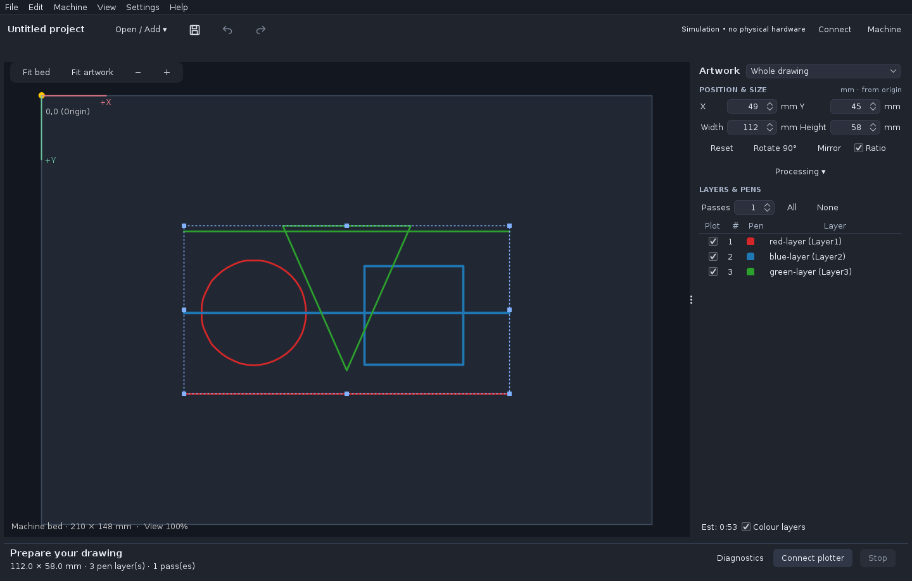
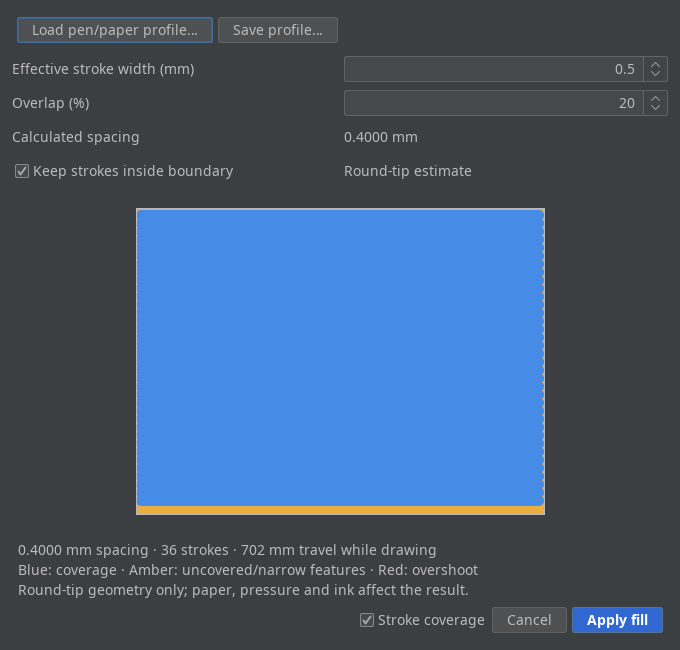

# Gantry

An all-Java toolkit that prepares SVGs for pen plotters and drives the plotter
directly: optimize → position → process → stream/export G-code. Raster images
(PNG/JPG) can enter the same pipeline through the optional `vectorize` front
stage (image → SVG), in the GUI (**Add image or photo…**) or headless (`VectorizeCli`).

Gantry merges the SVG-prep features of [SVGToolBox](https://github.com/utrost/SVGToolBox)
with the processing and plotter-driving of SVG2WaterColor into a single
Java 17 / Maven multi-module project. Pen-plotting is the first-class, default
path; watercolor (paint stations + refill) is an optional stage layered on top.

The machine-aware Live View previews the configured workspace, final artwork
placement, assigned pen colour, plot inclusion, plot order, and physical nib width
before paper or ink is committed.



[More screenshots and capture details](docs/images/README.md) ·
[Documentation audit](docs/DOCUMENTATION_STATUS.md)

## Download and first run

Get the newest candidate from [GitHub Releases](https://github.com/utrost/Gantry/releases).
Installer releases provide **Windows x64 MSI** and **Linux x64 DEB** packages with
Java included. Windows targets Windows 10/11; Linux targets Ubuntu 22.04/24.04.
Other distributions and architectures are not yet validated.

- Windows: download `Gantry-<version>-windows-x64.msi`, install it, then open
  **Gantry** from the Start menu. Installation is for your Windows account and
  includes `gantry-cli.exe`, bundled Java, offline help and SVG samples. Candidate
  installers are currently unsigned.
- Ubuntu: download `Gantry-<version>-linux-x64.deb`, install it with
  `sudo apt install ./Gantry-<version>-linux-x64.deb`, then open **Gantry** from
  the applications menu.

The [1.0.0-rc.13 candidate](https://github.com/utrost/Gantry/releases/tag/v1.0.0-rc.13)
adds versioned upright profiles, complete stroke previews, prepared-route timing,
editable artwork, SVG/ZIP export and image-art reliability fixes. It is a testing
prerelease; physical-machine and human acceptance are still pending.
Dark is the default theme. Earlier releases remain available unchanged. Portable users can download the GUI JAR and run
`java -jar Gantry-<version>.jar` with Java 17 or newer, or build from source with
`./scripts/build.sh`.

Installer downloads contain the platform package, a standalone README, license,
version information and checksums. Portable GUI/CLI JARs and the complete offline
documentation ZIP are a separate download. See [installer contents](docs/packaging/README.md).

Start with the [guided mock first plot](docs/FIRST_PLOT.md) before using hardware.
Development after RC13 also offers **Settings → Simulation → Serial GRBL simulator**:
normal GUI workflows use the production serial backend without opening hardware.
Layer changes and final success now wait for an explicit completion barrier. See
the [verification and simulation limits](docs/release-results/2026-11-21-completion-serial-simulator.md);
these changes are absent from RC13 downloads.
Development source also adds read-only firmware/work-origin review, nine-point
placement references and an explicitly reviewed pen-only partial restart/reverse
workflow. Saved proposals never start motion automatically. See the
[contracts and verification](docs/release-results/2026-11-22-firmware-anchors-restart.md).
These additions are absent from RC13 downloads.
Watch the [one-minute mock walkthrough](docs/demos/Gantry-first-plot-mock.mp4):
actual app screens show import, preview, the pre-plot checklist, pen confirmation,
and completion. This captioned walkthrough simulates plotting; no hardware moves.

RC13 packages the coordinate, preview and estimate fixes and refreshed offline guides. Existing
calibrated profiles keep their mapping; upright migration requires explicit review
and new pen-up direction/frame checks. See the
[candidate evidence](docs/release-results/1.0.0-rc.13.md),
[operator worksheet](docs/release-results/1.0.0-rc.13-operator.md) and
[current software verification](docs/release-results/2026-11-21-prepared-route.md).
The held RC12 draft remains unchanged and predates these fixes.

Later development fixes watercolor refill geometry, rinse-pot color mapping,
station nudges and homing fault waits. These fixes are absent from RC13 downloads;
see the [fresh audit](docs/release-results/2026-11-21-watercolor-homing.md).


## Start here

- [`docs/FIRST_PLOT.md`](docs/FIRST_PLOT.md) — shortest path to a safe guided
  mock plot and then a small real plot.
- [`docs/SAMPLE_GALLERY.md`](docs/SAMPLE_GALLERY.md) — small known-good SVGs for
  mock practice, G-code export, and cautious first hardware checks.
- [`docs/USER_GUIDE.md`](docs/USER_GUIDE.md) — full operating guide.
- [`docs/TROUBLESHOOTING.md`](docs/TROUBLESHOOTING.md) — serial ports, GRBL
  states, launch problems, and first-run failures.
- [`docs/KNOWN_GOOD_SETUPS.md`](docs/KNOWN_GOOD_SETUPS.md) — evidence-based
  hardware/configuration reports.

See [ROADMAP.md](ROADMAP.md) for the active product plan and
[`docs/ADOPTION_ROADMAP.md`](docs/ADOPTION_ROADMAP.md) for the path to 2, 10,
25, and 100 real users. The original phased design diary is archived in
[docs/ROADMAP_HISTORY.md](docs/ROADMAP_HISTORY.md).

See [docs/TESTING.md](docs/TESTING.md) for the test suite and manual acceptance
checklist.

See [docs/PROJECT_DIGEST.md](docs/PROJECT_DIGEST.md) for a compact project map
covering documentation, roadmap state, adoption blockers, and recommended next
work.

See [docs/TRACER_CAPTURE_IMPORT.md](docs/TRACER_CAPTURE_IMPORT.md) for the
documented future handoff contract from Tracer JSON captures into Gantry. This is
not yet a current user workflow.

See [docs/ARCHITECTURE.md](docs/ARCHITECTURE.md) for a detailed technical
reference of the module graph, data model, pipeline, threading model, and
extension points (written to be consumed by an LLM or a new contributor).

See [docs/LESSONS_LEARNED.md](docs/LESSONS_LEARNED.md) for the design principles,
the ledger of bugs already fixed (so they aren't reintroduced), development and
verification gotchas, and an FAQ — read before extending the system.

See [CONTRIBUTING.md](CONTRIBUTING.md) before opening larger issues or pull
requests.

## Modules

| Module | Purpose |
|---|---|
| `model` | Shared DTOs (Point, Layer, Command, ...) and coordinate transforms |
| `svgtoolbox-core` | SVG→SVG processors: path optimize, simplify, hatch, palette, crop, rotate |
| `pipeline-core` | Flatten, position, multipass, command model, output orchestration — pen plotting works end-to-end with just this module |
| `watercolor` | Optional: paint station mapping and refill-split |
| `plotter` | GRBL backend (jSerialComm or serial simulator), lightweight mock, `.gcode` writer |
| `vectorize` | Optional front stage: raster image (JPG/PNG)→SVG (BoofCV/Batik tracing) feeding the SVG pipeline |
| `cli` | Headless entry point |
| `app` | Swing/FlatLaf GUI and orchestration service |

The original projects this was merged from live in their own repositories
([SVGToolBox](https://github.com/utrost/SVGToolBox),
[SVG2WaterColor](https://github.com/utrost/SVG2WaterColor)); they were kept
under `legacy/` as a reference during the port and have since been removed.

## Building

```
mvn clean package
```

## Scripts

The `scripts/` directory has helper scripts for Linux/macOS (`.sh`) and
Windows (`.cmd`), all run from the repo root:

| Script | Purpose |
|---|---|
| `update.sh` / `update.cmd` | `git pull` the current branch |
| `build.sh` / `build.cmd` | `mvn clean install` everything (pass `--skip-tests` to skip tests) |
| `start.sh` / `start.cmd` | Launch the Gantry GUI (`app/target/app-1.0.0.jar`), building it first if missing |
| `test-gui.sh [GUI-JAR] [RESULTS]` | Exercise mock/recovery and production-backend serial-simulator GUI workflows (Linux/JDK/display) |
| `capture-screenshots.sh [GUI-JAR]` | Refresh the screenshot gallery using temporary mock profiles (Linux/JDK/display) |
| `start-novice-study.sh` | Launch the GUI from an isolated clean profile for novice-study participants |
| `release.sh` / `release.cmd` | Build versioned GUI/CLI artifacts under `dist/<version>/`; add `--installer` for the host installer |

Release builds require Python 3.9+ as well as Java/Maven; native installers
require JDK 21+ with jpackage. Portable JARs still run on Java 17+. For example:
`./scripts/release.sh 1.0.0-rc.13 --installer` (Windows: `scripts\release.cmd 1.0.0-rc.13 --installer`).

Tagged releases are staged as drafts by GitHub Actions after both installers pass. See
[`docs/RELEASE_CHECKLIST.md`](docs/RELEASE_CHECKLIST.md) for the required mock
and real-hardware acceptance record.

Requires Java 17+ and Maven 3.8+ on `PATH`.

## License

Gantry is licensed under the **GNU Affero General Public License v3.0** — see
[LICENSE](LICENSE). The `vectorize` module incorporates the
[Vectorize](https://github.com/utrost/vectorize) (BoofCV-Batik Vectorizer)
sources (AGPLv3) and the public-domain
[ImageTracer](https://github.com/jankovicsandras/imagetracerjava).

## Predictable filled areas

Use effective stroke width and optional overlap to calculate parallel-line spacing:
`spacing = width × (1 − overlap / 100)`. A 0.5 mm stroke with 20% overlap gives
0.4 mm spacing. Preview gaps, overshoot and narrow features before applying.



Saved pen/paper profiles and labelled calibration swatches help tune real ink
coverage. These create artwork only; plotting still uses Check and Start.
See [the filling guide](docs/USER_GUIDE.md#hatch-filling-a-region-click-to-fill).
