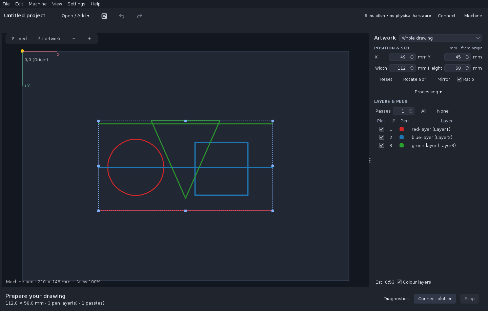
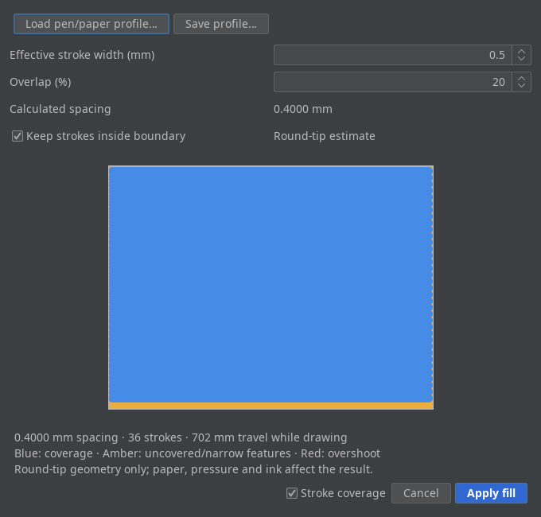

# Current Gantry screenshots — RC10

All current PNGs in this directory were regenerated on 2026-11-14 from actual
Swing components on Linux / Java 17. Dark is the default; Light remains available.
Canvas appearance is independent. The captures use isolated mock profiles; no
physical plotter was connected. Native window borders are excluded where root
panes are captured. Nothing here is an AI-generated UI mockup.

## Daily workspace



- [Empty](workspace/empty.png), [dismissed hint](workspace/empty-dismissed.png)
- [Prepared](workspace/prepared.png), [selected artwork](workspace/selected-artwork.png)
- [Machine controls](workspace/machine.png), [disabled movement](workspace/disabled-machine.png)
- [Check](workspace/check.png), [pen change](workspace/pen-change.png), [running](workspace/running.png)
- [Stopped](workspace/stopped.png), [failure presentation](workspace/failure.png)
- [Larger workspace](workspace/large-workspace.png)
- [Light prepared](workspace/light-prepared.png), [Light check](workspace/light-check.png)
- [SVG import](workspace/svg-import.png), [raster import](workspace/raster-import.png)
- [Stored-job review](workspace/historical-review.png), [saved result with retained error](workspace/save-feedback.png)

The failure state is injected to verify presentation. Mock job captures do not
establish physical motion completion or real alarm recovery.

## Fill preparation



- [Light fill preview](pen-fill/fill-light.png)
- [Processing with coverage](pen-fill/processing.png)
- [Calibration artwork](pen-fill/calibration.png)

Coverage uses a round-tip geometric approximation. Ink, pressure, speed and paper
can change the physical result. Calibration artwork remains subject to preflight.

## Setup and settings

- [Welcome](first-run-guided-practice.png)
- [Layer pen/watercolor properties](layer-watercolor-settings.png)
- [Connection](settings-connection.png)
- [Application](settings-application.png)
- [Machine geometry](settings-machine-geometry.png)
- [Pen and speeds](settings-pen-speeds.png)
- [Watercolor stations](settings-watercolor-stations.png)

## Reproduce

With Java and a graphical display (or Xvfb):

```bash
mvn package
./scripts/capture-screenshots.sh app/target/app-1.0.0.jar
./scripts/record-demo.sh dist/demo
```

The capture script refreshes all current screenshots. The demo script requires
ffmpeg and produces the captioned one-minute mock video. Both use temporary
profiles and application rendering rather than desktop capture. Inspect generated
images before committing. The full scale/density acceptance matrix is separate:
`./scripts/test-workspace-layouts.sh` exercises both themes, both densities and
100%, 125%, 150%, 200% scales. Historical dated audit images are evidence of older
revisions and are not presented as current screenshots.
