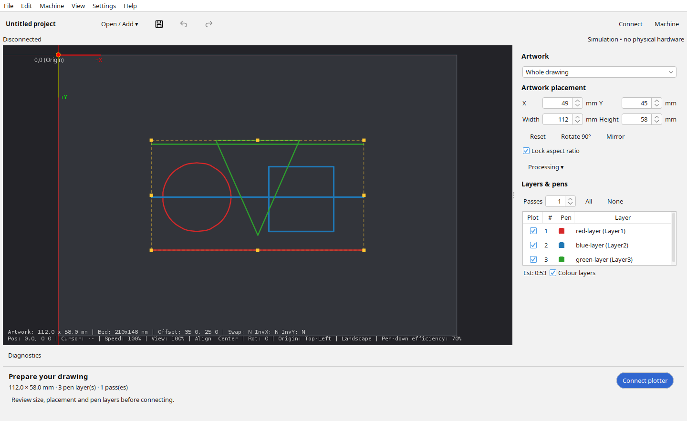
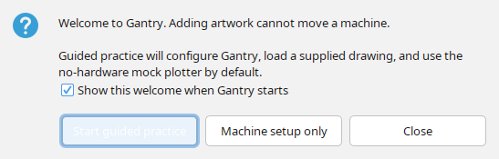
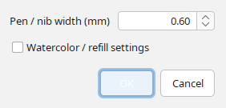
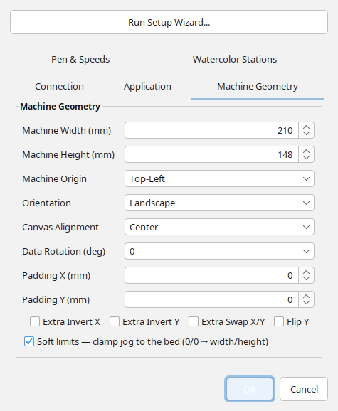

# Application screenshots

Workspace and import captures refreshed 2026-11-11 from the current implementation, on Linux with Java 17.
Dark is the default application theme; canvas appearance remains independent.
The welcome, watercolor-settings and geometry images below are earlier RC3 reference captures.

These are captures of the running application's Swing root panes, rendered by
Swing itself because desktop screen capture returned black pixels. Native window
borders are excluded. No AI-generated interface or artwork is used. The harness
uses an isolated mock profile, loads the committed gallery SVG through the real
importer, and opens the real dialogs. No plotter was connected.

## Workspace and layer preview

The [multi-colour sample](../samples/multi-colour-layers.svg), with its three
layers selected, in a 210 × 148 mm workspace. The control panel uses its default width; long layer names retain their full text
in tooltips. The current workspace capture uses the default 0.3 mm preview nib width.



## Welcome



## Per-layer watercolor settings



## Machine geometry



## Reproduce

From the repository root on Linux with a JDK and an available graphical display
(or Xvfb), build the release JAR and run:

```bash
./scripts/capture-screenshots.sh dist/1.0.0-rc.3/Gantry-1.0.0-rc.3.jar
```

The script compiles the developer-only capture harness, creates a temporary
profile and replaces these four PNGs. It cleans up the temporary profile on exit.
Inspect the images before committing them. Private UI entry points are used to
prepare repeatable views; this is a documentation tool, not a GUI acceptance test.

## Workspace reference states

The executable `scripts/test-workspace-layouts.sh` generates both themes at four
scale factors. Selected logical-pixel captures are committed here:

- [Empty](workspace/empty.png)
- [Prepared (Dark)](workspace/prepared.png) and [Light prepared](workspace/light-prepared.png)
- [Check](workspace/check.png)
- [Running](workspace/running.png)
- [Pen change](workspace/pen-change.png)
- [Failure presentation](workspace/failure.png), injected by the capture harness

The job and pen-change captures use only the mock backend. The failure image
verifies presentation, not physical alarm handling.
