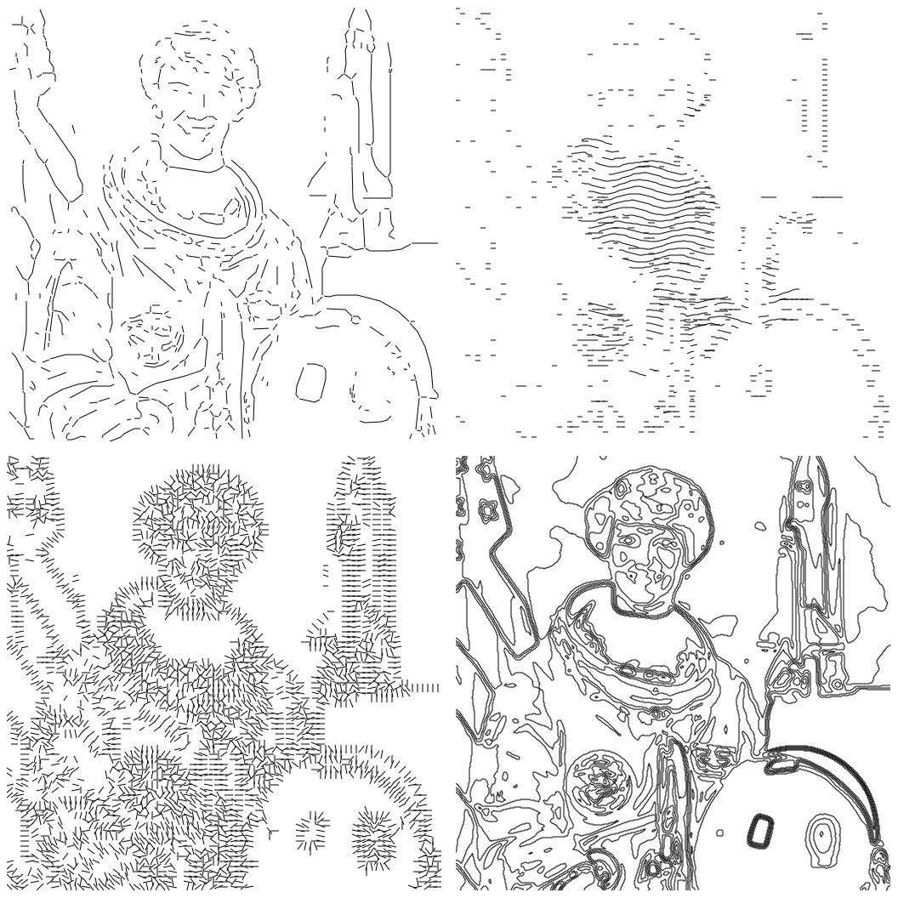
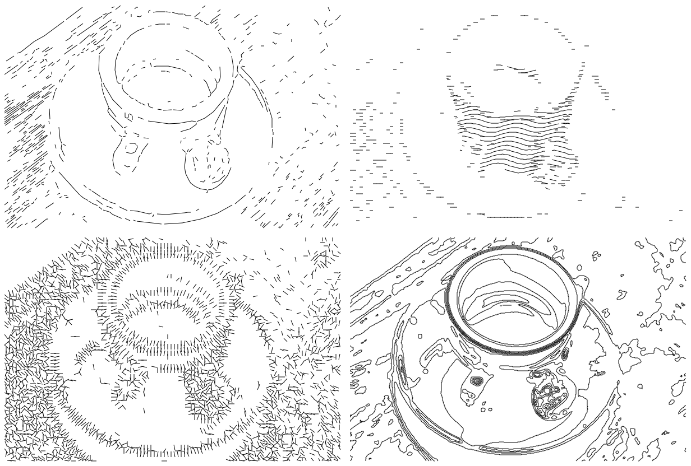
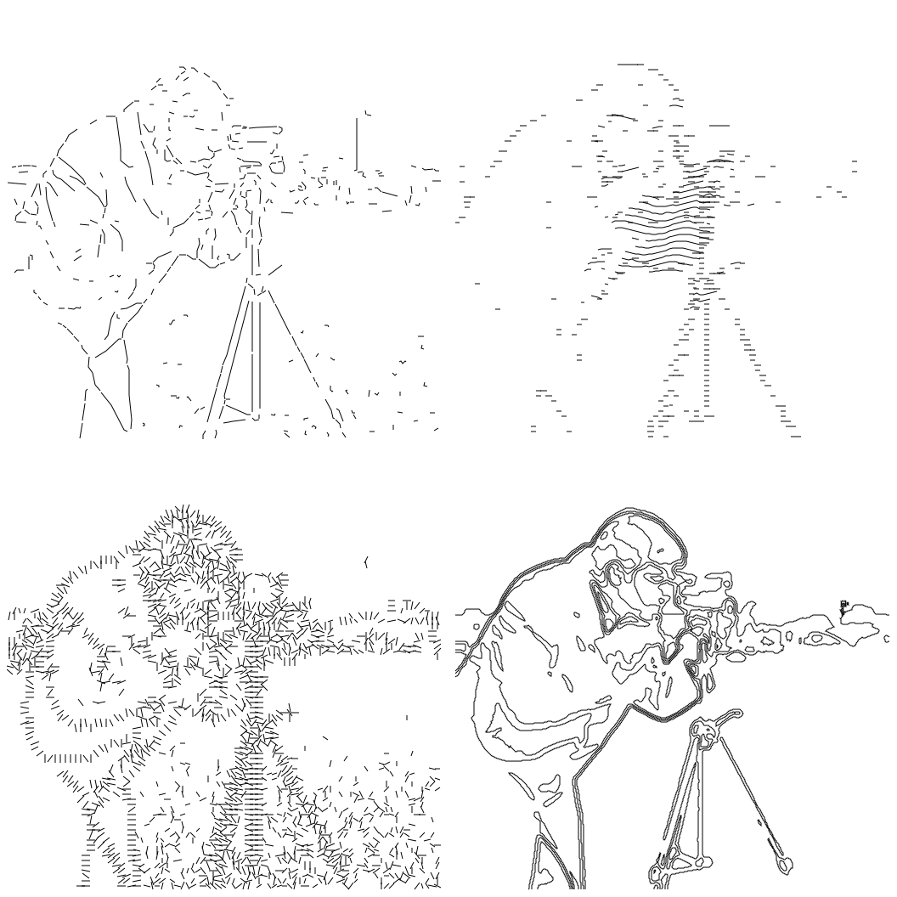

# Real-image art comparison

> Historical baseline at `29e8ac4`, before #85. For current Squiggle behavior,
> visual comparisons and reproduction commands see the
> [subject-retention fix](squiggle-fix/README.md). Reproduce the original
> commands below on `29e8ac4`; current CI uses the reviewed fixed baseline.

Sketch produces decent sparse outlines on this small corpus. Needles and Isolines
produce recognizable stylizations with substantial detail/cost caveats. The
baseline Squiggle recipe fails the visual quality bar on all three photographs;
a single global adjustment recovers recognizable subjects at a much higher
plotting cost. **Twelve valid exports are not twelve quality passes.** No product
default or processing engine was changed.

This is the software and visual validation for [#80](https://github.com/utrost/Gantry/issues/80),
on baseline `c0ed443`, 2026-11-20. Public RC11 assets remain unchanged.

## Corpus and permission

The three original PNGs total 1.34 MiB. They are photographs, not synthetic
fixtures. No resizing, cropping, recolouring or recompression was applied.
[corpus.json](corpus.json) records exact source URLs, upstream revision,
SHA-256, dimensions, creator, role and redistribution basis. The pinned source is
scikit-image v0.25.2, revision `e8a42ba85aaf5fd9322ef9ca51bc21063b22fcae`.

| Image | Role / dimensions | Creator and redistribution permission |
|---|---|---|
| [Astronaut](inputs/astronaut.png) | Tonal portrait, 512 × 512 | NASA photograph of Eileen Collins; upstream records public-domain status, with no known copyright restrictions |
| [Coffee](inputs/coffee.png) | Textured object, 600 × 400 | Rachel Michetti, courtesy of Pikolo Espresso Bar; CC0 dedication by the photographer |
| [Camera](inputs/camera.png) | High-contrast scene, 512 × 512 | Lav Varshney; CC0 dedication by the photographer |

The permission evidence is the corresponding `astronaut`, `coffee` and `camera`
functions in the [pinned upstream documentation source](https://github.com/scikit-image/scikit-image/blob/e8a42ba85aaf5fd9322ef9ca51bc21063b22fcae/skimage/data/_fetchers.py).
CC0 terms: [CC0 1.0](https://creativecommons.org/publicdomain/zero/1.0/).
Camera is the replacement image used since v0.18, not the older image
removed over copyright restrictions. These source-image permissions also apply
to the derived previews here; Gantry's repository license does not override them.
No private or tester photographs are used.

## Fixed recipe and repeatability

[recipes.json](recipes.json) fixes every active mode parameter. One recipe per
mode applies to every photograph; there is no per-image tuning. Inputs retain
native resolution. Vector output uses a black 1 px stroke, no fill. Squiggle has
tolerance 2 (row spacing 8 px), detail .6, density 1, amplitude 3.5, tone .72 and
background suppression .85. Sketch, Needles and Isolines use their explicitly
recorded parameters. These four algorithms use no random generator; seed is
not applicable. Hand-drawn jitter, hatching, crop, simplification and merging
are disabled.

All outputs use a 180 × 180 mm fit frame with 10 mm padding, aspect preserved,
one pass, no refills, curve step .1 mm and imported-stroke reordering enabled.
The importer fits **visible vector content**, not the photograph's page; sparse
modes can therefore have a different content crop/scale. Exact resulting bounds
are retained per artifact in [verification.json](verification.json).
The preview sheets instead preserve each source image's coordinate frame, making
lost features apparent. Their nominal stroke width is not a physical ink simulation.

[machine.json](machine.json) fixes the same 200 × 200 mm bed, 1200 mm/min draw,
3000 mm/min travel and 80 ms pen-down dwell for all runs. Servo commands are
configured for file validation only; no serial connection or hardware is opened.

Each combination ran twice. SVG and G-code are byte-identical; metrics are
identical after JSON canonicalization; normalized command models are identical.
Only command metadata `generatedAt` and `source` are removed for comparison.
No geometry tolerance is needed. Both repeat and committed-baseline checks run
in CI on Java 17 and Java 21. Hashes, JDK/build identity, finite in-bed point
counts and production `GcodeFileReplay.preflight` results are in verification.json.
[comparison.json](comparison.json) is the existing `ImageArtValidationCli` report;
its global fastest/lowest-travel summaries are cost summaries, not quality winners.

## Visual review: is it at least decent?

These are agent visual assessments of rendered vectors against the source
photographs, not external-user ratings or physical plots. The review asks:

1. Can the subject and its key features be recognized, without relying only on its caption?
2. Does the treatment retain useful structure/tonal separation, without dominant artifacts or distracting clutter?
3. Are fragmentation, lost detail and stroke/motion cost acceptable for the stated style and size?

“Decent” below means a useful stylized preparation candidate, not photographic
likeness or print quality. “Conditional” means a specific aesthetic/cost tradeoff
needs acceptance; “poor” means lost subject structure or an artifact dominates.
None of the three baseline Squiggle images qualifies simply because it is cheap.

Every sheet uses **Sketch / Squiggle on the top row, Needles / Isolines below**.
Click the source links above to compare with the photograph. All twelve exact
SVGs are retained in [previews/](previews/); no case is hidden.

### Astronaut portrait



| Mode | Visual finding | Verdict |
|---|---|---|
| Sketch | Face, suit collar and helmet remain recognizable. Hair, eyes and suit lettering fragment or disappear; a spare outline, not a faithful likeness. | Decent sparse outline |
| Squiggle | Face/hair nearly disappear; shading concentrates in the collar/central oval. Subject depends heavily on contextual hints. | Poor |
| Needles | Suit and helmet read well; face becomes angular dash texture and individual likeness is lost. 3,102 lifts/strokes are expensive. | Conditional textural study |
| Isolines | Clear silhouette, collar and helmet; face becomes nested contour bands and the background flag/rocket competes. | Conditional contour study |

### Coffee and textured wood



| Mode | Visual finding | Verdict |
|---|---|---|
| Sketch | Cup, saucer, handle and spoon remain legible. Wood becomes scattered marks and dark/light surfaces lose their tone. | Decent outline |
| Squiggle | A central shaded oval replaces the cup/saucer structure; rim, handle and spoon mostly vanish. | Poor |
| Needles | Circular cup/saucer structure survives, but wood and cup compete as a dense spiky field; spoon/handle clarity is weak. | Conditional texture effect |
| Isolines | Cup rim, saucer, handle and spoon read clearly; wood patches become conspicuous contour islands and close rim bands may merge in ink. | Decent stylization, physical detail check needed |

### High-contrast photographer scene



| Mode | Visual finding | Verdict |
|---|---|---|
| Sketch | Photographer, camera and tripod are recognizable. Jacket contour is broken and distant buildings are largely removed. | Decent minimal outline |
| Squiggle | Central streaks partly suggest a person/tripod but erase the face/camera relationship and much of the jacket. | Poor |
| Needles | Pose and camera/tripod survive as directional texture. Face detail and coat mass are weakened; foreground texture adds noise. | Conditional textural study |
| Isolines | Strong photographer/camera silhouette and clear tripod; dark coat becomes a mostly blank region edged by tight nested bands. | Decent contour stylization |

## Cost and warnings

Distances are millimetres; travel share is travel / (draw + travel).
Tiny means a positive **segment** shorter than .5 mm, not a separate tiny stroke.
The contour modes contain many small connected segments; their counts alone do
not prove bad ink output. Conversely, “zero tiny segments” does not prove quality.
All twelve combinations have a warning; none is silently declared ready to plot.

| Image / mode | Strokes | Draw mm | Travel mm | Travel share | Tiny segments | Feed+dwell estimate |
|---|---:|---:|---:|---:|---:|---:|
| astronaut-sketch | 596 | 2691.8 | 3871.1 | 59.0% | 0 | 4:20 |
| astronaut-squiggle | 624 | 2129.1 | 3981.8 | 65.2% | 0 | 3:56 |
| astronaut-needles | 3,102 | 9610.4 | 10095.8 | 51.2% | 0 | 15:31 |
| astronaut-isolines | 288 | 10884.0 | 2499.5 | 18.7% | 30,272 | 10:17 |
| coffee-sketch | 580 | 1935.0 | 2910.3 | 60.1% | 8 | 3:21 |
| coffee-squiggle | 369 | 1292.4 | 2355.3 | 64.6% | 0 | 2:21 |
| coffee-needles | 2,556 | 6686.8 | 7016.6 | 51.2% | 0 | 11:19 |
| coffee-isolines | 183 | 5415.0 | 1831.7 | 25.3% | 17,114 | 5:22 |
| camera-sketch | 368 | 1407.0 | 2289.3 | 61.9% | 4 | 2:26 |
| camera-squiggle | 395 | 1303.9 | 2333.1 | 64.1% | 0 | 2:23 |
| camera-needles | 1,824 | 5404.8 | 5786.3 | 51.7% | 0 | 8:52 |
| camera-isolines | 99 | 4201.7 | 1190.0 | 22.1% | 11,510 | 4:02 |

Sketch, Squiggle and Needles trigger `HIGH_TRAVEL_RATIO` (at least 50%) on every
image, even after reordering. Isolines triggers `TINY_SEGMENTS` on every image;
Sketch also has 8/4 tiny segments for coffee/camera. No run triggers
`LONG_PLOT_TIME` (one hour). Full warning codes/values/thresholds, command/point
counts and finite bounds are in verification.json.

These estimates sum nominal draw/travel feed time and per-stroke pen-down dwell.
They exclude acceleration, serial/planner overhead, initial positioning, final
park, physical pen dynamics and any operator pauses. The upper-thousands of
short independent strokes in Needles or adjusted Squiggle may take appreciably
longer. No measured plotting duration is claimed.

## Squiggle adjustment: quality improves, cost rises

One **global experiment**, retained separately from the baseline, sets tolerance
1.5 (row spacing 6 px), detail 1, density 1.5, tone 1 and background suppression
0; amplitude stays 3.5. All other import/machine settings remain fixed.
[squiggle-experiment.json](squiggle-experiment.json) and
[squiggle-experiment-verification.json](squiggle-experiment-verification.json)
record the recipe and the six repeated runs. All repeats and preflights pass.


The face/suit/helmet, cup/saucer and photographer/camera now read as subjects.
This is a usable stylized starting point. Detail remains wavy and broken,
peripheral dark regions are still weakened, and photographic likeness is limited.
It is not an unconditional quality pass or a replacement default.

| Image | Strokes before → adjusted | Estimate before → adjusted |
|---|---:|---:|
| Astronaut | 624 → 2,902 | 3:56 → 23:34 |
| Coffee | 369 → 2,540 | 2:21 → 17:04 |
| Camera | 395 → 2,122 | 2:23 → 16:00 |

The implementation always applies a centre-weighted Gaussian foreground prior
and suppresses some flat dark peripheral areas, even with background=0. This is
a plausible source of the observed centre bias, not evidence of image understanding.
[#85](https://github.com/utrost/Gantry/issues/85) tracks subject retention, honest
controls/help and an explicit quality/cost acceptance before any default change.
The separate packaged PNG export failure is tracked by
[#84](https://github.com/utrost/Gantry/issues/84); SVG previews avoid that failing path.

## Reproduce

Use Python 3 (standard library) and JDK 17 or 21, including `javac`. Build first:

```bash
mvn clean package
python3 scripts/validate-image-art.py \
  --output /tmp/gantry-image-art-review \
  --baseline docs/validation/image-art/verification.json
python3 scripts/validate-image-art.py \
  --recipes docs/validation/image-art/squiggle-experiment.json \
  --output /tmp/gantry-squiggle-review \
  --baseline docs/validation/image-art/squiggle-experiment-verification.json
```

Choose new output directories: the runner refuses to overwrite an existing run.
No network/download or third-party Python dependency is needed. Each run logs
its exact CLI invocation and retains SVG, vectorizer metadata, command JSON,
metrics, G-code, production preflight result and aggregate comparison report.
The runner uses `VectorizeCli` → `SvgImportCli --metrics --gcode` →
`ImageArtValidationCli`; it does not substitute another rendering engine.

The committed contact sheets were rendered for visual inspection using
ImageMagick 6.9.12-98 (optional, not a CI dependency). For each image, render the
four saved SVGs with `convert -background white input.svg output.png`, then:

```bash
montage sketch.png squiggle.png needles.png isolines.png \
  -tile 2x2 -geometry 512x512+8+8 -background white comparison.png
# Coffee uses 600x400+8+8; the experiment uses a 3x1 layout at 512x512+8+8.
```

Sources and preview SVGs are compact committed evidence. Bulk commands/G-code,
logs and repeated files stay outside version control. CI uploads those artifacts
under its existing validation-evidence upload. A passing hash check protects the
reviewed result; it is not an automated aesthetic judgment.

## Verification of this change

Full clean reactor build: 590 Java tests with no failures/errors/skips; nine
Python packaging tests passed. Both the baseline and adjusted recipe were
rerun against their committed hashes using the rebuilt CLI. Java 17/21 CI also
runs both recipes, plus the existing GUI/layout and installer checks. No
physical plot or external-user acceptance is claimed.

## Next decisions

Keep existing defaults. Offer Sketch as an outline experiment with its known
losses, and review Needles/Isolines/adjusted Squiggle by intended aesthetic and
acceptable stroke cost. Prioritize #85 over adding another engine. Fine-line
legibility, ink pooling, acceleration cost and actual durations need the separate
operator acceptance run. This corpus is three examples, not evidence of broad
photo coverage or participant satisfaction.
