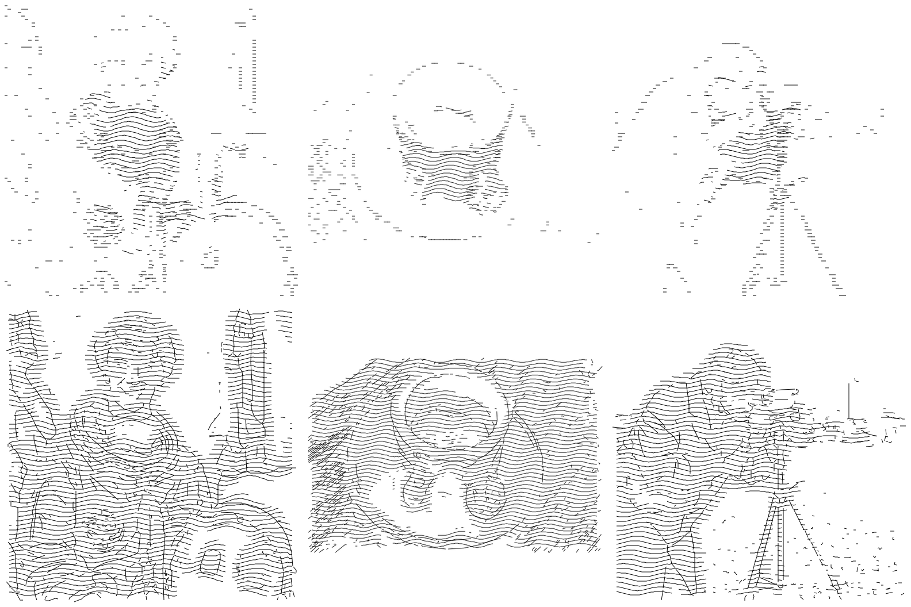
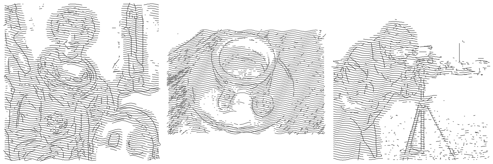

# Squiggle subject-retention fix

The unchanged standard recipe now preserves the astronaut's facial outline and
helmet, the cup rim/handle/spoon, and the photographer/camera/tripod. These are
decent stylized studies on this corpus, with visible limitations: horizontal
bands flatten tonal differences, wood texture competes with the cup, and fine
facial/detail information is still lost. This is a visual quality judgment,
not a claim based only on successful generation.

Issue [#85](https://github.com/utrost/Gantry/issues/85), baseline `29e8ac4`,
2026-11-20. The [original review](../README.md), including its poor Squiggle
results and expensive workaround, remains historical evidence. Inputs and
redistribution permissions are unchanged; see [corpus.json](../corpus.json).

## What changed

Squiggle is a general image stylization, not a centre-weighted portrait effect.
The positional Gaussian foreground mask and unconditional peripheral-dark
rejection are removed. Shading depends on tone and local detail, wherever they
occur. A lower tonal threshold retains more midtone subject structure.

The former horizontal edge dashes are replaced with connected contours from
Gantry's **existing adaptive sketch tracer**. This retains structural features
without another engine or a tone-fidelity rewrite. With Detail > 0, contour
settings are window 21 px, offset .04, skeleton enabled and minimum length
`max(6, round(12 - 10 * detail))`. At Detail = 0 these contours are disabled.

**Flat dark suppression** attenuates locally flat dark areas throughout the
image. Zero disables that attenuation, including at the edges. It does not
identify a background or distinguish a flat dark jacket from a backdrop.
The control tooltip and CLI help say so; the strategy/preset label now says
**Tonal squiggle shading**. Saved CLI strategy/parameter keys and numeric preset
values remain unchanged. No beginner default is promoted.

The sinusoidal phase and sampling grid still depend on coordinates, as expected
for a horizontal-line style. This fix removes position-based foreground
selection; it does not promise pixel-for-pixel translation invariance for
arbitrary shifts, boundary clipping or sine phase.

## Before / after at identical parameters

Columns: astronaut, coffee, camera. Top: previous implementation. Bottom: fixed
implementation. Every image uses the original [standard recipe](../recipes.json):
tolerance 2, detail .6, density 1, amplitude 3.5, tone .72, suppression .85;
180 × 180 mm fit with 10 mm padding, one pass, no refills and path reordering.
All six individual before/after SVGs are available: old ones in
[the original previews](../previews/), new ones in [previews/](previews/).
Contact-sheet rendering uses the same white background and nominal 1 px stroke;
it does not simulate ink width/bleeding.



| Image | Visual quality judgment | Remaining limitation |
|---|---|---|
| Astronaut | Facial outline, collar and helmet read together; the head no longer vanishes above a central shaded patch. Decent line-art study. | Hair/face shading is banded; suit lettering and individual likeness are weak. Flag and rocket remain competing structure. |
| Coffee | Cup rim, saucer, handle and spoon are recognizable instead of a disconnected central oval. Decent stylization. | Horizontal bands flatten cup/wood separation; the wood contours are busy. |
| Camera | Photographer's face/camera relationship, jacket silhouette and tripod survive across the frame. Decent graphic study. | Fine facial features and background buildings remain incomplete; flat dark suppression can hollow dark coat regions. |

The denser original workaround is **not** required to recover these features.
The standard recipe has 71–73% fewer strokes and 35–52% lower feed/dwell estimates
than that workaround, while clearly costing more than the poor original output.

| Image | Original strokes / estimate | Original workaround | Fixed standard |
|---|---:|---:|---:|
| Astronaut | 624 / 3:56 | 2,902 / 23:34 | 799 / 13:12 |
| Coffee | 369 / 2:21 | 2,540 / 17:04 | 744 / 11:04 |
| Camera | 395 / 2:23 | 2,122 / 16:00 | 578 / 7:38 |

All fixed standard runs still trigger `HIGH_TRAVEL_RATIO` (52–54% travel).
Coffee and camera retain 8/4 positive sub-.5 mm segments; astronaut has zero.
These are segments within paths, not separate tiny strokes. More ink/motion is
the price of restored structure. The short original estimate was not useful
when the subject was missing.

## Actual Processor Studio preset

The existing preset uses detail .7 and density 1.2, with all other Squiggle
values as above. It was reviewed on all three photographs too, not assumed to
match the CLI standard recipe. [studio-recipe.json](studio-recipe.json) records
the exact values; [studio-verification.json](studio-verification.json) retains
geometry hashes, finite bounds, warnings and costs.



Its subjects remain recognizable with the same visual limitations. It uses
858 / 811 / 695 strokes and estimates 14:56 / 12:40 / 8:59 respectively. The
slightly denser texture costs more; the numeric preset was not increased to
make this fix look better.

All estimates use the shared [machine configuration](../machine.json):
1200 mm/min draw, 3000 mm/min travel, 80 ms pen-down dwell, 200 × 200 mm bed.
They exclude acceleration, planner/serial overhead, initial/final positioning,
physical pen behavior and operator pauses. Actual plotting time and ink quality
remain operator acceptance.

## Regression evidence and reproduction

- Shifted-subject regression compares translated geometry with zero sine
  amplitude and grid-aligned translations, with suppression both zero and .85.
  The same dark feature survives at three positions, including off-centre.
- Zero-suppression regression checks flat dark tone extends across the whole
  image; maximum suppression omits a uniform dark field.
- Connected-contour regression checks a long vertical feature remains connected
  rather than becoming horizontal dashes. Existing deterministic/white-background,
  suppression, density and CLI-parameter tests also pass.
- Full clean package: 593 Java tests, no failures/errors/skips; nine Python
  packaging regressions. Full mock GUI acceptance runs without a real machine.
- Every photo/mode in the four-mode standard corpus runs twice. Only the three
  Squiggle entries change; all other nine geometry/metrics hashes match the
  original record. Typed command reload, finite in-bed points and production
  G-code replay preflight pass. The real Studio preset runs twice per image too.

[verification.json](verification.json) is the current 12-artifact baseline;
[comparison.json](comparison.json) is the existing aggregate CLI report. Both
current standard and Studio baselines run in Java 17/21 CI. Geometry comparisons
ignore only command provenance timestamp/source, not drawing differences.

```bash
mvn clean package
python3 scripts/validate-image-art.py \
  --output /tmp/gantry-squiggle-fix \
  --baseline docs/validation/image-art/squiggle-fix/verification.json
python3 scripts/validate-image-art.py \
  --recipes docs/validation/image-art/squiggle-fix/studio-recipe.json \
  --output /tmp/gantry-squiggle-studio \
  --baseline docs/validation/image-art/squiggle-fix/studio-verification.json
```

Use new output directories. Python standard library and JDK 17/21 suffice; no
network or machine is used. To reproduce the original implementation and its
workaround, use commit `29e8ac4` and the original report's commands instead.
The historical files deliberately keep their original hashes and observations.

The quality assessment above is an agent review of software-rendered output,
not an external-user panel or a physical plot. No claim of photographic tone
fidelity, broad image coverage, stable release readiness or measured print
quality follows from this small corpus. PNG export remains separately tracked
in [#84](https://github.com/utrost/Gantry/issues/84).
